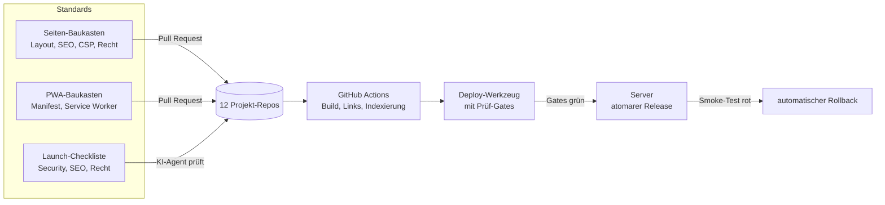

# Hallo, ich bin Enrico 👋

**Senior Software Developer aus Potsdam.** Ich entwickle Webanwendungen von der Anforderung bis zum laufenden Betrieb, seit 2011 mit PHP, später auch mit Java und TypeScript.

Mir ist wichtig, dass Software für Nutzer genauso verständlich ist wie für das Team, das sie weiterentwickelt. Deshalb interessiert mich nicht nur der Code, sondern auch alles drumherum: Deployment, Qualitäts-Gates und Standards, die über viele Projekte hinweg halten.

## Woran ich gerade arbeite

Neben meiner Arbeit betreibe ich rund ein Dutzend Web-Projekte: eigene Ideen, aber auch Seiten, mit denen ich Vereine und Initiativen unterstütze, von statischen Seiten bis zu einer Vereinsverwaltung in Laravel. Damit das mit wenig Aufwand stabil bleibt, habe ich eine kleine Plattform gebaut:

- **Ein Standard, viele Projekte:** Gemeinsame Bausteine kommen per Pull Request in jedes Projekt, ohne npm-Registry und ohne Token in der CI.
- **Deployments, die sich selbst absichern:** Erst CI, Changelog, Qualität (axe, Lighthouse) und Kit-Stand prüfen, dann atomar umschalten, bei Fehlern automatisch zurück.
- **KI-Agenten mit festen Regeln:** Aufgaben laufen als Tasks mit Pull-Request-Pflicht und Freigabe, die Agenten setzen um, ich entscheide.

## Kontakt

🌐 [rufnak.de](https://www.rufnak.de) · 💼 [LinkedIn](https://www.linkedin.com/in/enricorufnak) · [XING](https://www.xing.com/profile/Enrico_Rufnak)

Die meisten meiner Projekte sind privat. Was hier öffentlich liegt, ist bewusst ausgewählt.
